# Deployment

## Minitask: File Permissions & Ownership Practice

## 1. Initial Setup

### Shell Command
Go to /srv folder:
```sh
cd /srv
```
Create /srv/projectX directory:
```sh
sudo mkdir projectX
```
Add user "koda":
```sh
sudo adduser koda
```
Add user "dako":
```sh
sudo adduser dako
```
Add group "devteam" and add user "koda" and "dako" to group "devteam":
```sh
sudo groupadd devteam
sudo usermod -aG devteam koda
sudo usermod -aG devteam dako
```

### Screenshoot

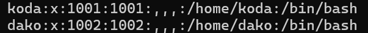
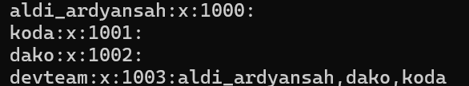

## 2. Make koda the owner and devteam the group owner of /srv/projectX

### Shell Command
```sh
sudo chown -R koda:dako /srv/projectX
sudo usermod -aG sudo koda
```

### Screenshoot
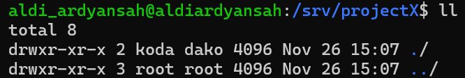

## 3. Restricting access

### Shell Command
```sh
sudo chmod 750 /srv/projectX
```

### Screenshoot
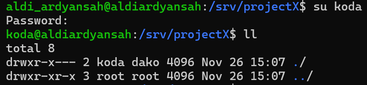

## 4. Create the following structure as user koda

### Shell Command
```sh
su koda
touch README.md
mkdir src
mkdir data
touch ./src/app.sh
touch ./data/input.txt
```

### Screenshoot
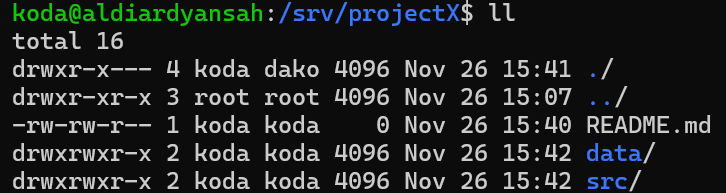

## 5. Fixing permissions

### Shell Command
```sh
chmod ug+x,o-x ./src/app.sh
```

### Screenshoot
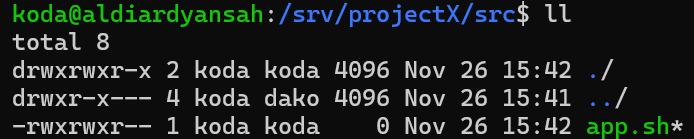

## 6. Protecting sensitive data

### Shell Command
```sh
chmod 600 ./data/input.txt
```

### Screenshoot
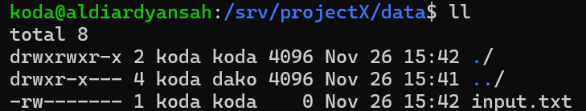

## 7. Allow group collaboration

### Shell Command

 Changes the group ownership of src and all files inside it (-R) to group "devteam":

```sh
chgrp -R devteam ./src
```

 Grants the group (g) read (r) and write (w) permissions:
 ```sh
chmod -R g+rwX ./src
```

### Screenshoot
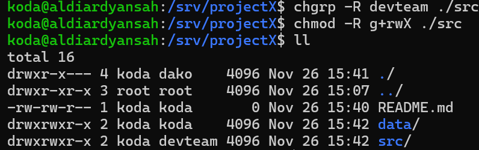

## 8. Change ownership

### Shell Command
```sh
chown -R koda:devteam /srv/projectX
```

### Screenshoot
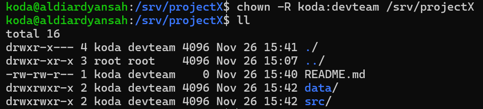

## 9. Prevent accidental deletion

### Shell Command
```sh
chmod -R u=rwX,g=rwXs,o=rX /srv/projectX
```

### Screenshoot
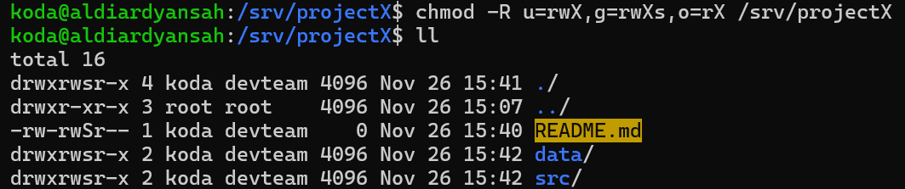

## 10. Make Readme readonly

### Shell Command
```sh
sudo chmod 644 /srv/projectX/README.md
```

### Screenshoot
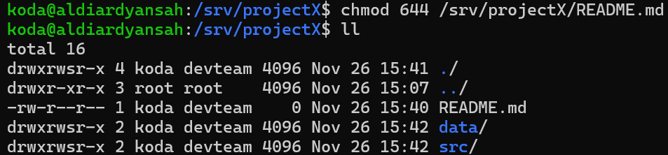

## 11. Resignation and project handover

### Shell Command
```sh
sudo chown -R dako:devteam /srv/projectX
```

### Screenshoot
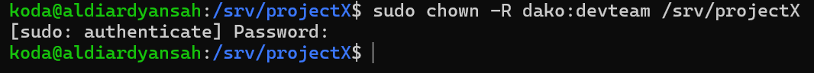